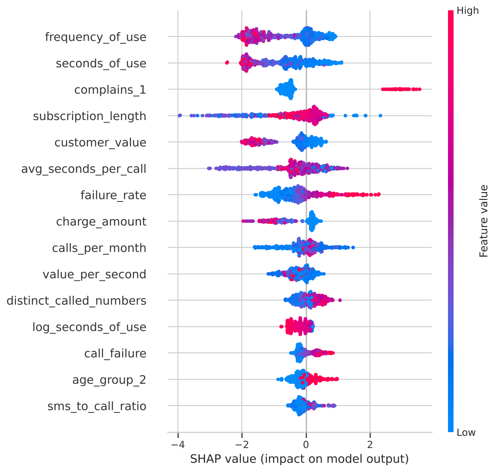
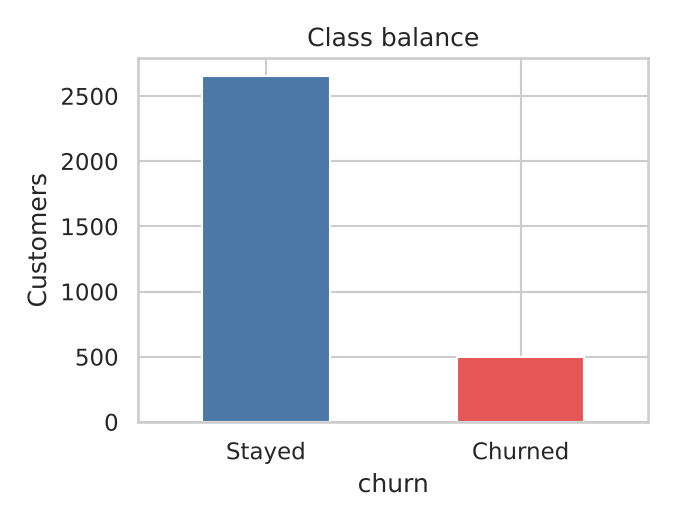
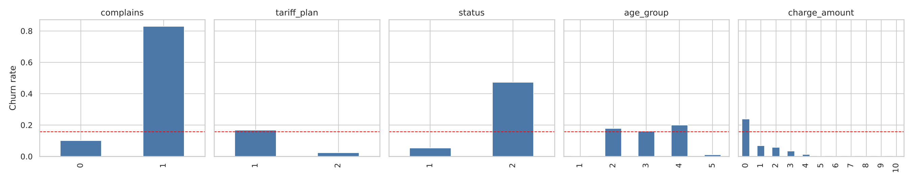
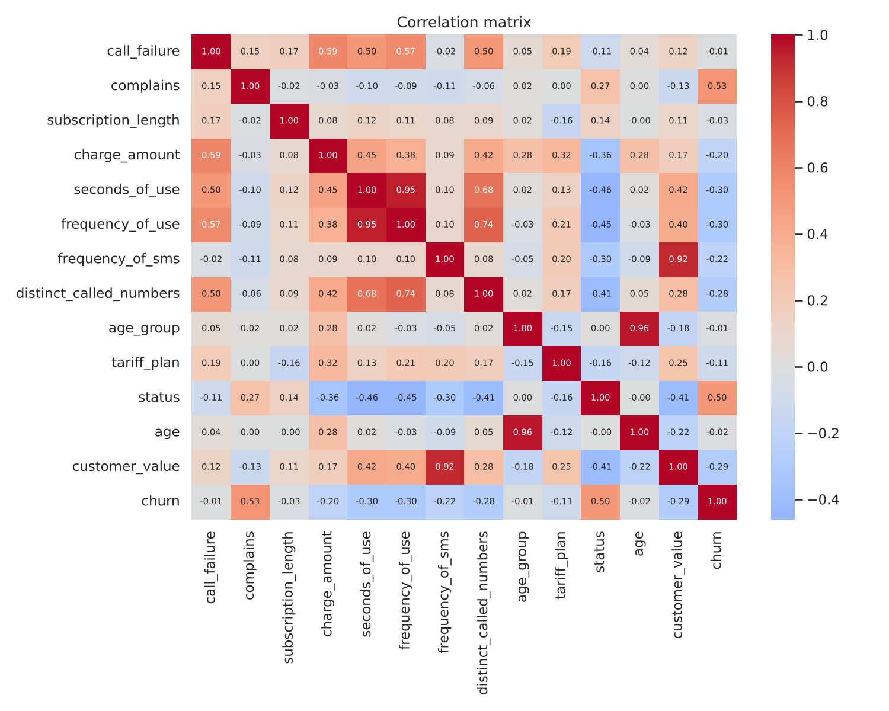
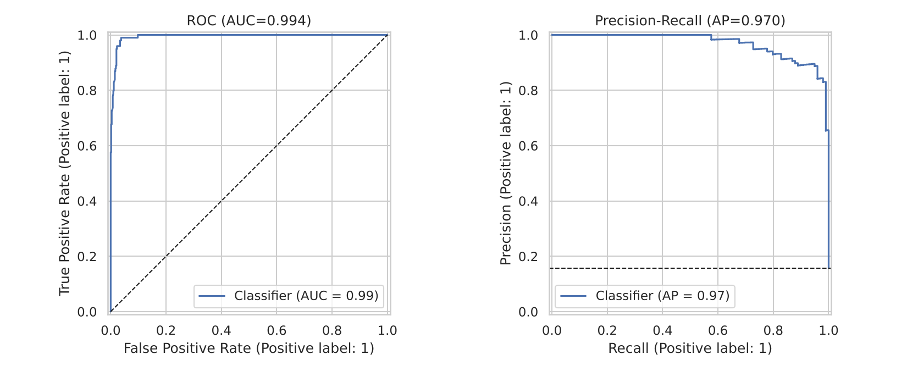
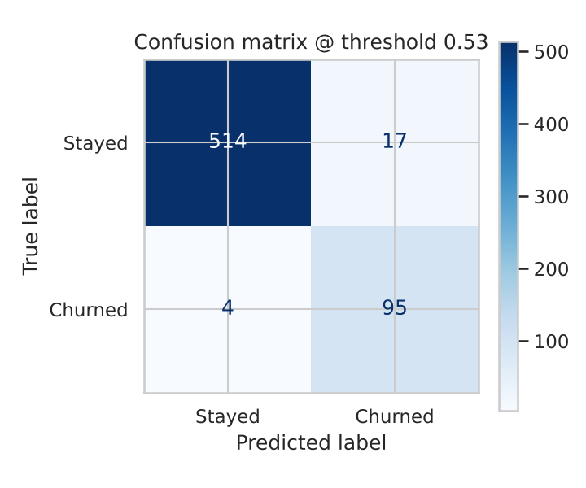
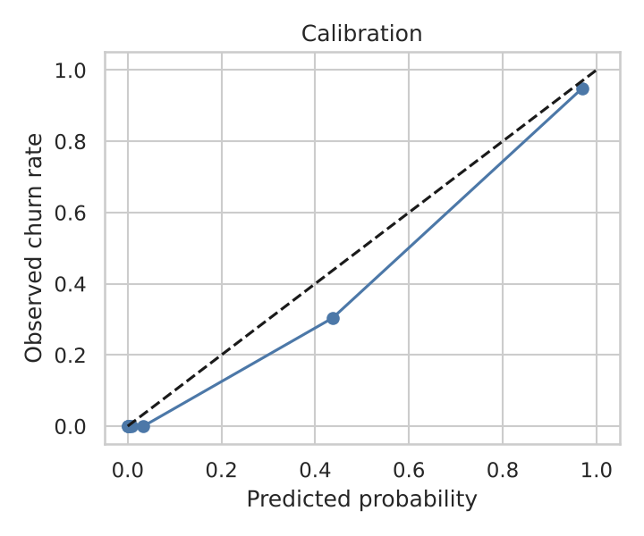
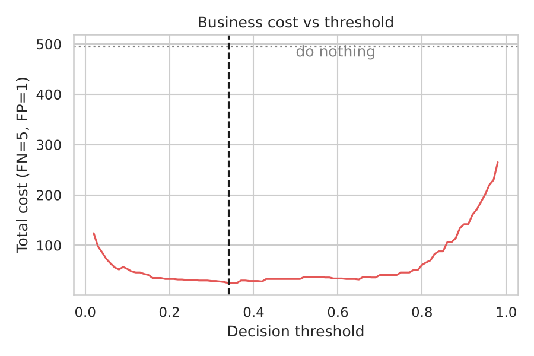

```markdown
# 📉 Telecom Customer Churn Prediction

[](https://www.python.org/downloads/)
[](https://opensource.org/licenses/MIT)

An end-to-end, production-grade machine learning project predicting telecom customer churn. This repository demonstrates a complete data science lifecycle: **Exploratory Data Analysis (EDA) → Leakage-Aware Feature Engineering → Model Comparison → Threshold Optimization → SHAP Interpretability → Business Cost Analysis**.

**Dataset:** 3,150 telecom customers | 13 features | Binary `Churn` target (15.7% churn rate, no missing values).

---

## 🧠 Core Machine Learning Concepts Applied

This project is built on rigorous ML engineering principles. Below are the key concepts implemented:

1. **Imbalanced Classification & Metric Selection:** 
   With only ~16% positive class (churners), standard accuracy is a misleading metric. The pipeline optimizes for **Average Precision (PR-AUC)** and **F1-Score**, which heavily penalize false negatives (missing a churner) and false positives (wasting retention budget).
2. **Data Leakage Prevention:** 
   * **Stateless Pipelines:** All feature engineering (log transforms, ratio creation) is encapsulated inside a scikit-learn `Pipeline` and fitted *only* on training folds during Cross-Validation.
   * **Out-of-Fold Thresholding:** The optimal decision threshold is calculated using out-of-fold predictions, ensuring the test set remains 100% unseen until final evaluation.
   * **Proxy Variable Removal:** The `status` feature (active/inactive) is a direct proxy for churn and was explicitly dropped from the final deployed model.
3. **Stratified Cross-Validation:** 
   5-Fold Stratified CV ensures that the 16% churn ratio is preserved in every fold, providing a stable estimate of model variance.
4. **Model Interpretability (SHAP):** 
   Tree-based models are often "black boxes." **SHAP (SHapley Additive exPlanations)** is used to provide both global feature importance and local instance-level explanations, proving *why* the model makes specific predictions.
5. **Cost-Sensitive Decision Theory:** 
   Instead of using a default 0.5 probability threshold, the model uses a **Cost Curve** to select the optimal threshold based on a business-defined cost ratio (e.g., the cost of a missed churner vs. the cost of a wasted retention offer).
6. **Probability Calibration:** 
   Evaluating how well the predicted probabilities match the true observed frequencies (crucial for ranking customers by risk level).

---

## 💡 Business Impact & Key Findings

* **Massive Cost Reduction:** Under an assumed 5:1 cost ratio (missed churner vs. wasted retention offer), deploying this model's predictions **cuts total retention costs by ~93%** compared to a "do nothing" baseline.
* **High-Risk Profiles:** Customers who file a **complaint churn at 83%**, compared to just 10% for those who don't. 
* **Usage Drop-offs:** Churners use the service far less: median **1,182 vs 3,530 seconds** of use and **25 vs 63 calls**.
* **Tariff Sensitivity:** Tariff plan 2 customers churn at just 2.4%, compared to 16.8% for plan 1.


*SHAP Summary: Red indicates high feature values, blue indicates low. High complaints and low usage drive churn probability up.*


*Global Feature Importance: Frequency of use, seconds of use, and complaints are the top 3 drivers.*

---

## 🚀 Quick Start

```bash
# 1. Clone the repository
git clone https://github.com/yourusername/churn-prediction.git
cd churn-prediction

# 2. Setup environment
python -m venv venv
source venv/bin/activate  # On Windows: venv\Scripts\activate
pip install -r requirements.txt

# 3. Run the full pipeline (EDA, training, evaluation, tests)
./run_all.sh                       # Takes ~1-2 minutes

# 4. Launch the interactive Streamlit dashboard
streamlit run app/streamlit_app.py 
```

---

## 📂 Project Structure

```text
churn-prediction/
├── app/                          # Streamlit interactive dashboard
│   └── streamlit_app.py
├── data/                         # Raw dataset
│   └── Customer_Churn.csv
├── models/                       # Saved artifacts (pipeline, thresholds)
│   └── churn_model.joblib
├── reports/
│   ├── figures/
│   │   ├── 01_class_balance.png
│   │   ├── 02_churn_rate_by_category.png
│   │   ├── 03_numeric_distribution.png
│   │   ├── 04_correlation.png
│   │   ├── 05_roc_pr.png
│   │   ├── 06_confusion_matrix.png
│   │   ├── 07_calibration.png
│   │   ├── 08_cost_curve.png
│   │   ├── 09_shap_summary.png
│   │   └── 10_shap_bar.png
│   ├── ablation.csv              # Leakage check results
│   ├── eda_findings.txt
│   ├── evaluation_notes.txt
│   └── metrics.json
├── src/
│   ├── __init__.py
│   ├── config.py                 # Global configurations and paths
│   ├── data.py                   # Data ingestion and splitting
│   ├── eda.py                    # Exploratory Data Analysis
│   ├── evaluate.py               # Metrics, SHAP, and business cost analysis
│   ├── features.py               # Stateless feature engineering
│   └── train.py                  # Model training and tuning
├── tests/
│   └── test_pipeline.py          # Pytest smoke tests
├── README.md
├── requirements.txt
└── run_all.sh                    # Master execution script
```

---

## 📊 Exploratory Data Analysis (EDA)

### Class Balance
The dataset is moderately imbalanced — only **~16% of customers churned** (499 out of 3,150). This dictates our choice of evaluation metrics (PR-AUC over ROC-AUC).



### Churn Rate by Category
Categorical features reveal strong signals. `complains` is the single strongest predictor. `status` (active/inactive) is also highly predictive but was excluded from the final model to avoid target leakage.



### Numeric Distributions by Churn Status
Churners (red) cluster at the low end of usage metrics — fewer seconds of use, fewer calls, fewer distinct numbers called, and lower customer value. Subscription length and call failure show more overlap between classes.


### Correlation Matrix
Strong multicollinearity exists among usage features (`seconds_of_use`, `frequency_of_use`, `distinct_called_numbers`, `customer_value` all correlate at 0.68–0.95). `age` and `age_group` are near-perfect duplicates (0.96), so `age` was dropped. `complains` correlates 0.53 with `churn` — the strongest single-feature relationship.



---

## 🛠️ Technical Methodology

### 1. Feature Engineering
* Created 6 behavioral/ratio features (e.g., avg seconds per call, SMS-to-call ratio, call failure rate, value per second).
* Applied log transforms to handle skewed numeric columns.
* Dropped `age` to prevent duplication with `age_group`.
* **Crucial:** All feature engineering is **stateless inside the scikit-learn `Pipeline`**, ensuring zero data leakage across Cross-Validation folds.

### 2. Modeling & Tuning
* **Models:** Majority class baseline, Logistic Regression, Random Forest, and XGBoost.
* **Imbalance Handling:** Addressed via class weights / `scale_pos_weight`.
* **Tuning:** `RandomizedSearchCV` (25 iterations) for XGBoost, optimizing for **Average Precision (PR-AUC)**.
* **Thresholding:** Decision threshold chosen on out-of-fold *train* predictions (max F1), strictly avoiding test-set leakage.

---

## 📈 Model Performance & Evaluation

*Deployed model excludes the `status` feature to prevent target leakage.*

| Metric | Value | Context |
| :--- | :--- | :--- |
| **ROC-AUC** | **0.994** | Excellent discrimination |
| **PR-AUC** | **0.970** | Baseline is 0.157; massive lift |
| **Recall** | **0.96** | Caught 95 of 99 actual churners |
| **Precision** | **0.85** | Low false-positive rate |
| **F1 Score** | **0.90** | Strong harmonic mean |

*5-fold CV on the train set yielded ROC-AUC 0.986, PR-AUC 0.937, F1 0.870. Logistic Regression peaked at PR-AUC 0.757, demonstrating the significant value of tree-based models for this data.*






*Calibration plot showing how well the predicted probabilities align with actual churn rates.*

---

## 💰 Business Cost Analysis

Machine learning models output probabilities, but businesses make binary decisions. Using a **Cost Curve**, we mapped the financial impact of False Positives (wasted retention offers) vs. False Negatives (lost revenue from churn).



Under an assumed **5:1 cost ratio**, the model identifies the optimal operating point, drastically reducing total expected cost compared to a naive baseline. *(The exact ratio can be adjusted dynamically in `src/evaluate.py`)*.

---

## 🛡️ Rigor, Limitations & Leakage Checks

*As a data scientist, I believe in transparent reporting. Here are the caveats regarding these results:*

1. **Unusually Strong Results:** The dataset is small, clean, and represents a single snapshot in time. Low usage metrics may be a *consequence* of a customer already leaving, rather than an early predictive signal. Treat the 0.99 AUC as an **upper bound** on what a live system would achieve.
2. **Leakage Mitigation:** The `status` feature (active/inactive) is a direct proxy for churn. The deployed model explicitly **excludes** it. 
3. **Ablation Studies:** Removing `status` and/or `complains` barely moves performance (ROC-AUC 0.995 → 0.993, see `reports/ablation.csv`). This proves the model is learning genuine behavioral patterns, not just relying on proxy flags.
4. **Statistical Uncertainty:** With only 99 test churners, metrics carry roughly ±3-4 points of uncertainty. A time-based train/test split would be the stronger validation strategy if timestamps were available.

---

## 🚀 Future Extensions

* **Uplift Modeling:** Shift from predicting *who will churn* to predicting *who will be retained by an offer* (Treatment vs. Control groups).
* **MLOps & Deployment:** Wrap the model in a FastAPI endpoint, containerize with Docker, and set up CI/CD via GitHub Actions running `run_all.sh`.
* **Tracking:** Integrate MLflow or Weights & Biases for experiment tracking, parameter logging, and model registry.

---

## 📄 License

This project is licensed under the MIT License - see the [LICENSE](LICENSE) file for details.
```