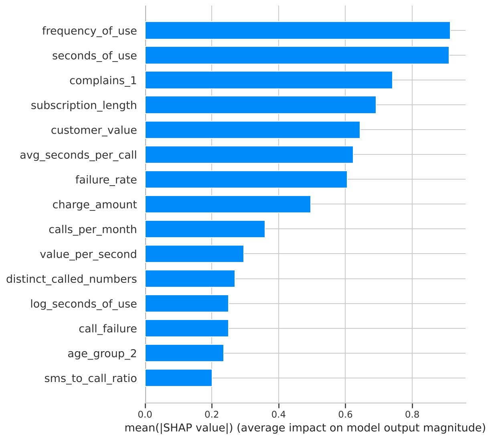

# 📉 Telecom Customer Churn Prediction

[](https://www.python.org/downloads/)
[](https://opensource.org/licenses/MIT)

An end-to-end, production-grade machine learning project predicting telecom customer churn. This repository demonstrates a complete data science lifecycle: **Exploratory Data Analysis (EDA) → Leakage-Aware Feature Engineering → Model Comparison → Threshold Optimization → SHAP Interpretability → Business Cost Analysis**.

**Dataset:** 3,150 telecom customers | 13 features | Binary `Churn` target (15.7% churn rate, no missing values).

---

## 🧠 Core Machine Learning Concepts Applied

This project is built on rigorous ML engineering principles. Below are the key concepts implemented:

1. **Imbalanced Classification & Metric Selection:** 
   With only ~16% positive class (churners), standard accuracy is a misleading metric. The pipeline optimizes for **Average Precision (PR-AUC)** and **F1-Score**, which heavily penalize false negatives (missing a churner) and false positives (wasting retention budget).
2. **Data Leakage Prevention:** 
   * **Stateless Pipelines:** All feature engineering (log transforms, ratio creation) is encapsulated inside a scikit-learn `Pipeline` and fitted *only* on training folds during Cross-Validation.
   * **Out-of-Fold Thresholding:** The optimal decision threshold is calculated using out-of-fold predictions, ensuring the test set remains 100% unseen until final evaluation.
   * **Proxy Variable Removal:** The `status` feature (active/inactive) is a direct proxy for churn and was explicitly dropped from the final deployed model.
3. **Stratified Cross-Validation:** 
   5-Fold Stratified CV ensures that the 16% churn ratio is preserved in every fold, providing a stable estimate of model variance.
4. **Model Interpretability (SHAP):** 
   Tree-based models are often "black boxes." **SHAP (SHapley Additive exPlanations)** is used to provide both global feature importance and local instance-level explanations, proving *why* the model makes specific predictions.
5. **Cost-Sensitive Decision Theory:** 
   Instead of using a default 0.5 probability threshold, the model uses a **Cost Curve** to select the optimal threshold based on a business-defined cost ratio (e.g., the cost of a missed churner vs. the cost of a wasted retention offer).
6. **Probability Calibration:** 
   Evaluating how well the predicted probabilities match the true observed frequencies (crucial for ranking customers by risk level).

---

## 💡 Business Impact & Key Findings

* **Massive Cost Reduction:** Under an assumed 5:1 cost ratio (missed churner vs. wasted retention offer), deploying this model's predictions **cuts total retention costs by ~93%** compared to a "do nothing" baseline.
* **High-Risk Profiles:** Customers who file a **complaint churn at 83%**, compared to just 10% for those who don't. 
* **Usage Drop-offs:** Churners use the service far less: median **1,182 vs 3,530 seconds** of use and **25 vs 63 calls**.
* **Tariff Sensitivity:** Tariff plan 2 customers churn at just 2.4%, compared to 16.8% for plan 1.


*SHAP Summary: Red indicates high feature values, blue indicates low. High complaints and low usage drive churn probability up.*


*Global Feature Importance: Frequency of use, seconds of use, and complaints are the top 3 drivers.*

---

## 🚀 Quick Start

```bash
# 1. Clone the repository
git clone https://github.com/yourusername/churn-prediction.git
cd churn-prediction

# 2. Setup environment
python -m venv venv
source venv/bin/activate  # On Windows: venv\Scripts\activate
pip install -r requirements.txt

# 3. Run the full pipeline (EDA, training, evaluation, tests)
./run_all.sh                       # Takes ~1-2 minutes

# 4. Launch the interactive Streamlit dashboard
streamlit run app/streamlit_app.py 